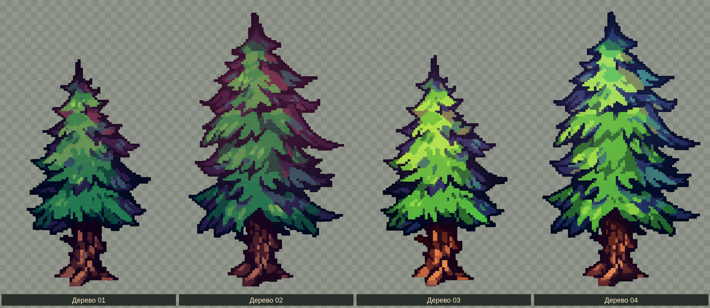

# Четыре стоящих дерева

Четыре хвойных дерева подготовлены по последнему присланному изображению и пока загружаются игрой. **Эта обработка изменила исходные цвета и рисунок, поэтому варианты отклонены и ожидают замены точной нарезкой оригинального PNG.** Взяты только стоящие деревья верхнего ряда, слева направо; пеньки и лежащие деревья не включены. На референсе указано `@KIANAMOSSER`. [Исходная публикация](https://x.com/kianamosser/status/984841145921429504/photo/1). Для точной нарезки нужен скачанный исходный файл: эта ссылка недоступна из текущей среды (HTTP 403).

[Открыть лист целиком](trees-preview.png)

| Вариант | Отдельный прозрачный PNG |
| --- | --- |
| 01 — тёмный | [pine-01-dark.png](sprites/pine-01-dark.png) |
| 02 — с пурпурными тенями | [pine-02-purple.png](sprites/pine-02-purple.png) |
| 03 — светлый | [pine-03-light.png](sprites/pine-03-light.png) |
| 04 — яркий | [pine-04-bright.png](sprites/pine-04-bright.png) |

Фон отделён при обработке референса; отдельные пиксели подготовленного рисунка могут отличаться от исходного изображения. Каждый PNG имеет прозрачность 0/255 и свободные поля по 8 пикселей. Рисунки в [trees-atlas.png](trees-atlas.png) совпадают с отдельными PNG пиксель в пиксель. Подложка предпросмотра не входит в игровые изображения.

[sprites.json](sprites.json) задаёт кадры атласа, точки опоры, размеры оснований и масштаб 0,375. Высота в игре — примерно 227–274 игровых единицы. Количество на локации — **45–63 включительно**, позиции и варианты случайны по всей площади. Столкновения относятся к основаниям стволов, кроны остаются навесами.

Отдельные кусты и камни удалены из игры. Прежний фон пола восстановлен, включая его текстуру травы. Мир 3840×2160, овальная камера и анимации друида сохраняются.

Проверены все четыре PNG и их соответствие атласу; игровые проверки сравнивают каждый пиксель загруженных кадров с этими файлами и проверяют генерацию, движение и столкновения.
