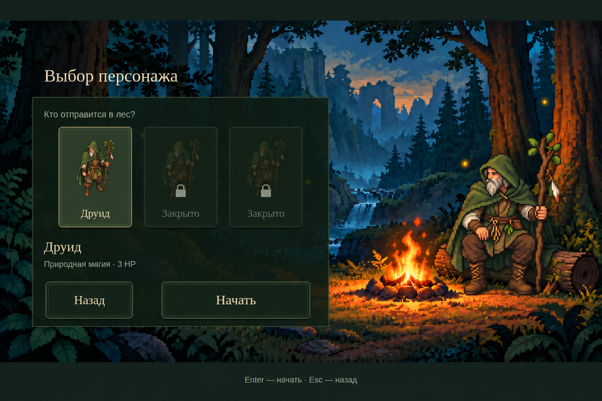
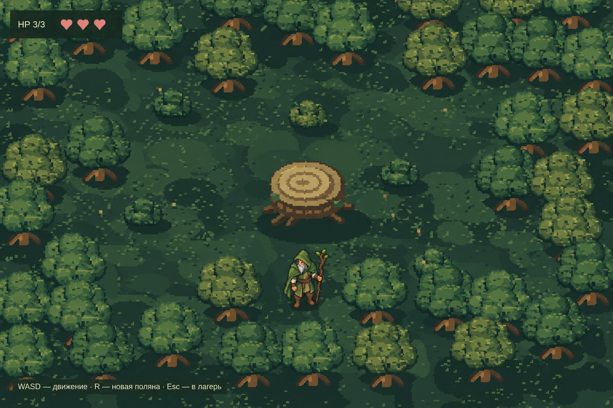

# Эскизы размера и детализации друида

Две одобренные картинки, сгенерированные по снимкам сцен и образу рабочего друида. На их основе были подготовлены отдельные прозрачные сидящий и игровой спрайты. Пользователь сохранил новый игровой вариант, но попросил вернуть предыдущего сидящего друида в меню; эта замена отменена. Эти PNG сохраняются как эскизы целых сцен; фон и интерфейс в игре остаются самостоятельными слоями.

## Экран выбора персонажа

[Открыть картинку](character-selection-preview.png)

Сидящий друид заметно крупнее предыдущего, ориентир по размеру — персонаж в главном меню. Позу поддерживает то же бревно; крупный портрет в ячейке остаётся отдельным элементом. Детализация увеличена умеренно, с сохранением крупных пиксельных форм.

## Игровой друид

[Открыть картинку](gameplay-druid-preview.png)

Ориентир — нынешний размер героя на поляне, с более ясными формами капюшона, лица, бороды, складок плаща и посоха. Мелкие украшения и шумная фактура не возвращаются.

## Эскизы и текущая интеграция

«На треть больше пикселей» в этой пробе означает увеличение разрешения примерно на треть **по каждой стороне**. Игровой вариант подключён; сидящий вариант после перерисовки отклонён, в меню возвращён предыдущий образ. PNG в этой папке сохраняют эскизы целых сцен.

| Вариант | Предыдущая сетка | Сетка в эскизе | Текущее состояние |
| --- | --- | --- | --- |
| Сидящий друид | 40×56 | 54×75 | Возвращён предыдущий вариант 40×56, 100×140 игровых единиц |
| Игровой друид | 24×30 | 32×40 | Прежний размер |

Для просмотра на компьютере выполните `git pull --ff-only` и откройте PNG в этой папке. На GitHub можно открыть картинку и скачать оригинал через «Download raw file». Рабочие прозрачные исходники: [сидящий друид](../../../src/assets/characters/druid-camp-source.png) и [игровой друид](../../../src/assets/characters/druid-game-source.png). Сидящая фигура возвращена к прежнему виду и отображается в размере 100×140 игровых единиц, игровая — в прежнем размере 87,5×109,375. Образы и размеры задаются в данных персонажа; главный экран и подробный портрет в ячейке сохранены.
