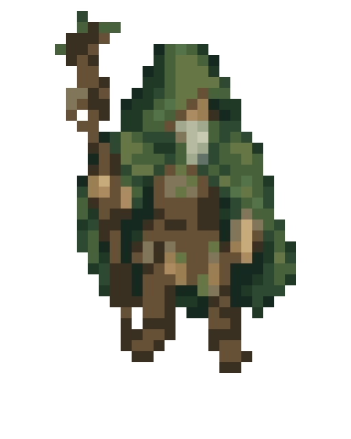
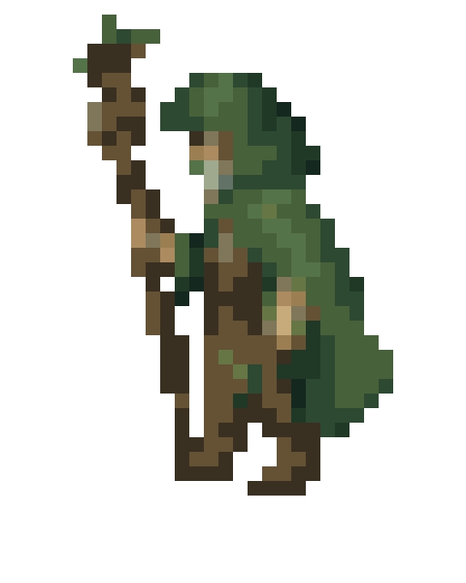
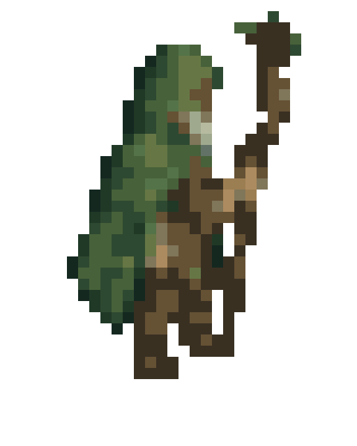
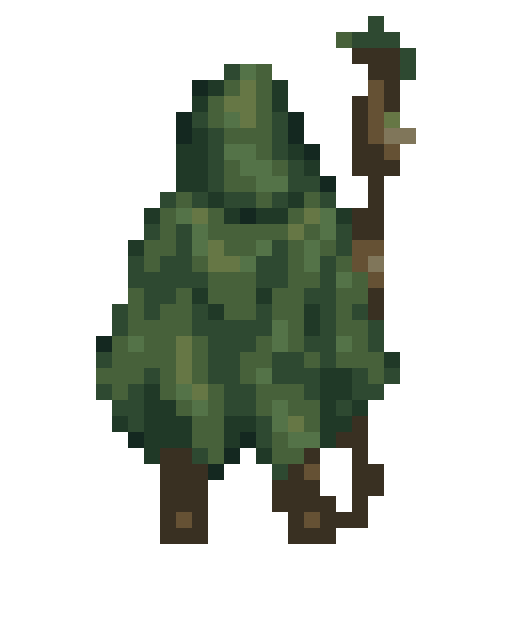
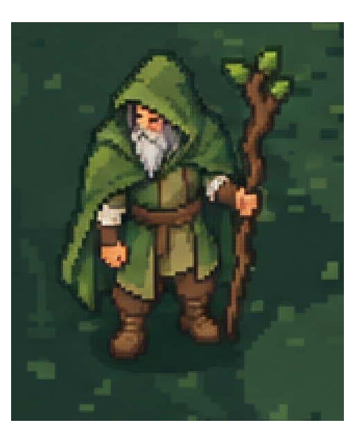
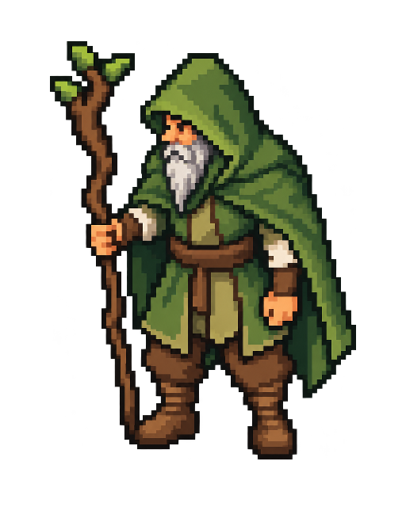
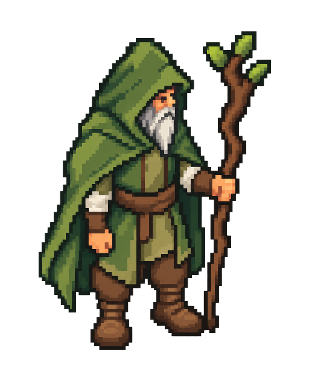
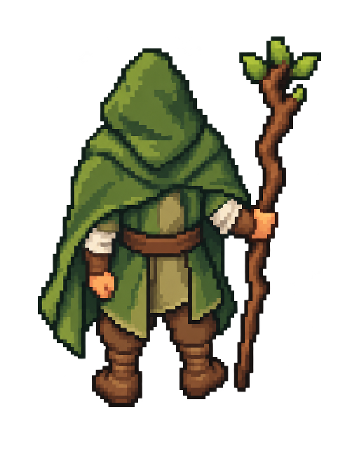

# Друид: два образа, четыре направления

**A — друид, который сейчас в игре. B — друид из указанного эскиза поляны.** Всего восемь PNG: два исходных вида и шесть новых ракурсов. Это картинки для сравнения; в игру они не подключены. Анимации пока нет.

## A — текущий игровой друид

| A1 — исходный вид | A2 — влево | A3 — вправо | A4 — спиной |
| --- | --- | --- | --- |
|  |  |  |  |

[Открыть A1](a-current-front.png) · [A2](a-current-left.png) · [A3](a-current-right.png) · [A4](a-current-back.png)

A1 экспортирован из настоящей игровой текстуры 32×40 и увеличен ровно в 16 раз без сглаживания. Это текущий вид героя, без перерисовки. Новые ракурсы A2–A4 сгенерированы по этому изображению и подготовлены в той же сетке 32×40 с действующей игровой палитрой до 16 цветов. Все четыре показываются в одинаковом масштабе.

## B — друид из эскиза по ссылке

| B1 — исходный вид | B2 — влево | B3 — вправо | B4 — спиной |
| --- | --- | --- | --- |
|  |  |  |  |

[Открыть B1](b-preview-front.png) · [B2](b-preview-left.png) · [B3](b-preview-right.png) · [B4](b-preview-back.png)

B1 — точный фрагмент [указанного эскиза](../druid-detail-preview-v1/gameplay-druid-preview.png): область (688, 612), размером 160×192 исходных пикселей, увеличенная в три раза без сглаживания. Вокруг героя сохранена трава; отделение от фона изменило бы исходную картинку. B2–B4 сгенерированы по этому фрагменту и полному эскизу. Это изображения новых ракурсов для оценки образа; окончательная рабочая сетка B пока не определена.

## Как сравнить

Все восемь файлов имеют рамку 512×640. A и B могут различаться детализацией; внутри каждого набора фигуры представлены в сопоставимом масштабе. Новые шесть PNG и исходный A имеют прозрачный фон. Направления обозначают взгляд героя относительно экрана; все позы неподвижные. Посох должен оставаться в правой руке персонажа, поэтому при виде со спины оказывается справа от зрителя.

Можно выбрать набор целиком — A или B — либо назвать отдельные картинки, например «B1 нравится, B4 нужно изменить». Для скачивания откройте PNG на GitHub и нажмите «Download raw file». После `git pull --ff-only` картинки находятся на компьютере в `docs/art/druid-directions-v1/`.

После выбора понадобится согласовать финальные ракурсы и выравнивание перед подготовкой кадров ходьбы или поворота. Игра, меню, текущие спрайты и управление на этом этапе не изменены.
