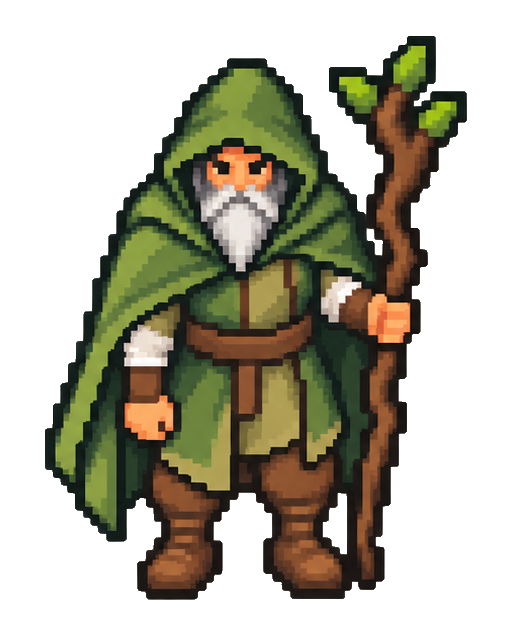
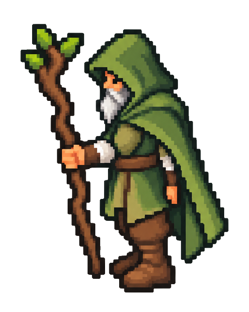
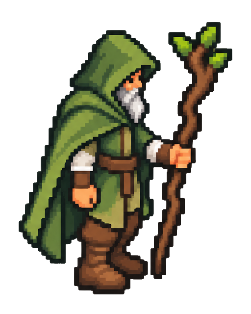
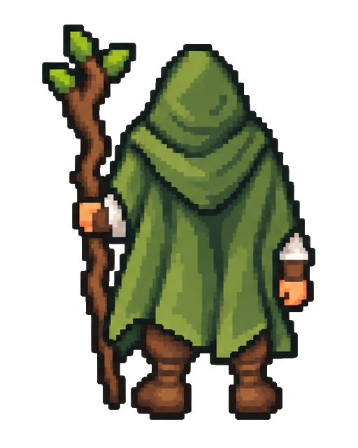

# Друид из эскиза: четыре направления

Новый набор только для друида из [указанного эскиза поляны](../druid-detail-preview-v1/gameplay-druid-preview.png). Отклонённые восемь картинок предыдущего набора удалены. Эти четыре PNG предназначены для обсуждения; в игру они не подключены, анимации ещё нет.

| 1 — лицом к игроку | 2 — влево | 3 — вправо | 4 — спиной |
| --- | --- | --- | --- |
|  |  |  |  |

[Открыть 1](01-front.png) · [Открыть 2](02-left.png) · [Открыть 3](03-right.png) · [Открыть 4](04-back.png)

Все четыре ракурса созданы в одной общей композиции по исходному эскизу, затем разделены на отдельные PNG. Это новые рисунки персонажа в разных направлениях, а не поворот головы поверх прежнего тела или зеркальная копия бокового вида. Ориентир для одежды, пропорций и детализации — герой из указанного эскиза, не текущая игровая текстура.

Посох закреплён за **левой рукой друида**, как в исходном эскизе: спереди он справа для зрителя, со спины — слева. При взгляде влево эта рука ближняя, при взгляде вправо — дальняя; свободная правая рука не должна перехватывать посох. Голова, корпус и стопы должны смотреть в одну сторону.

Размер каждого файла — **512×640**, фон прозрачный. Исходные фигуры сохранены без уменьшения разрешения и ограничения палитры; убрана слабая прозрачная дымка вне рисунка. Видимые границы целых фигур по высоте — 551–565 пикселей, нижняя граница выровнена на строку 600. Персонаж и посох полностью помещаются в кадре. Окончательные игровые размеры, точки опоры и кадры движения определим после выбора этих ракурсов.

Для просмотра на компьютере выполните `git pull --ff-only`: файлы находятся в `docs/art/druid-directions-v2/`. На GitHub откройте нужный PNG и нажмите «Download raw file» для скачивания.
