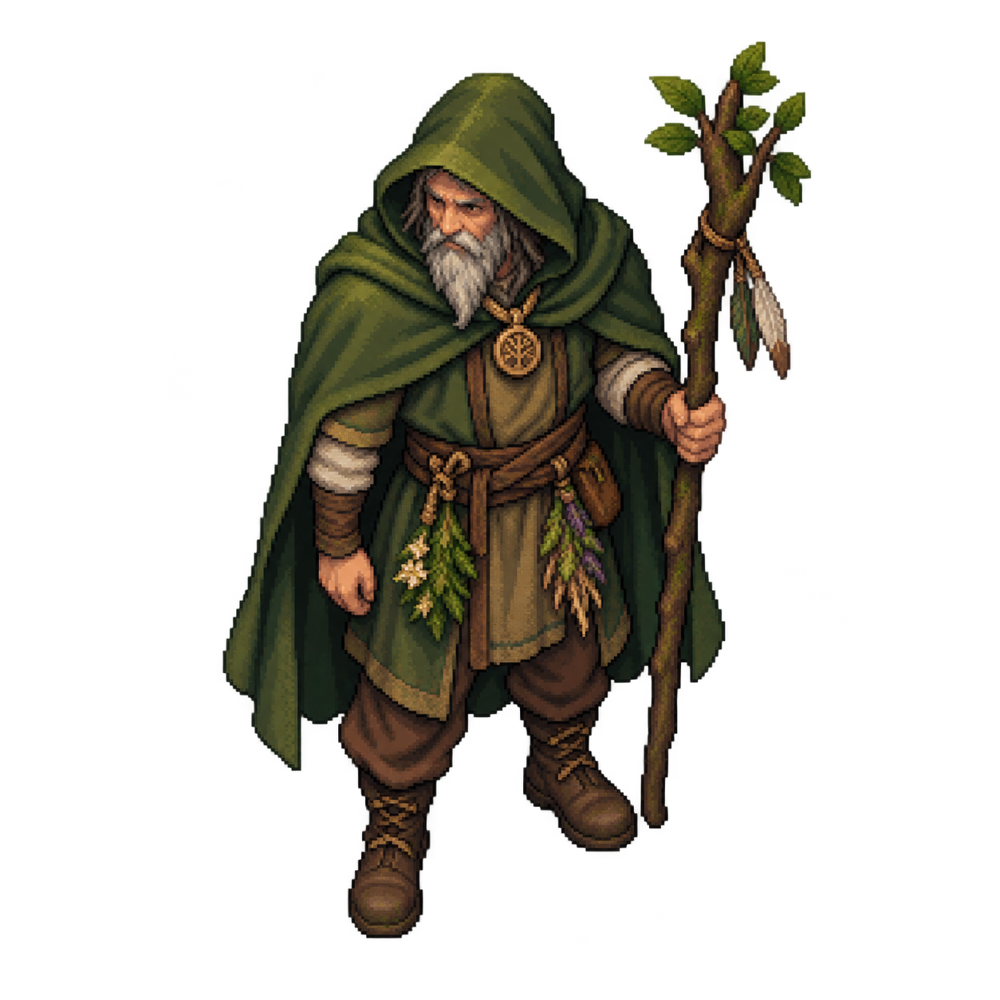
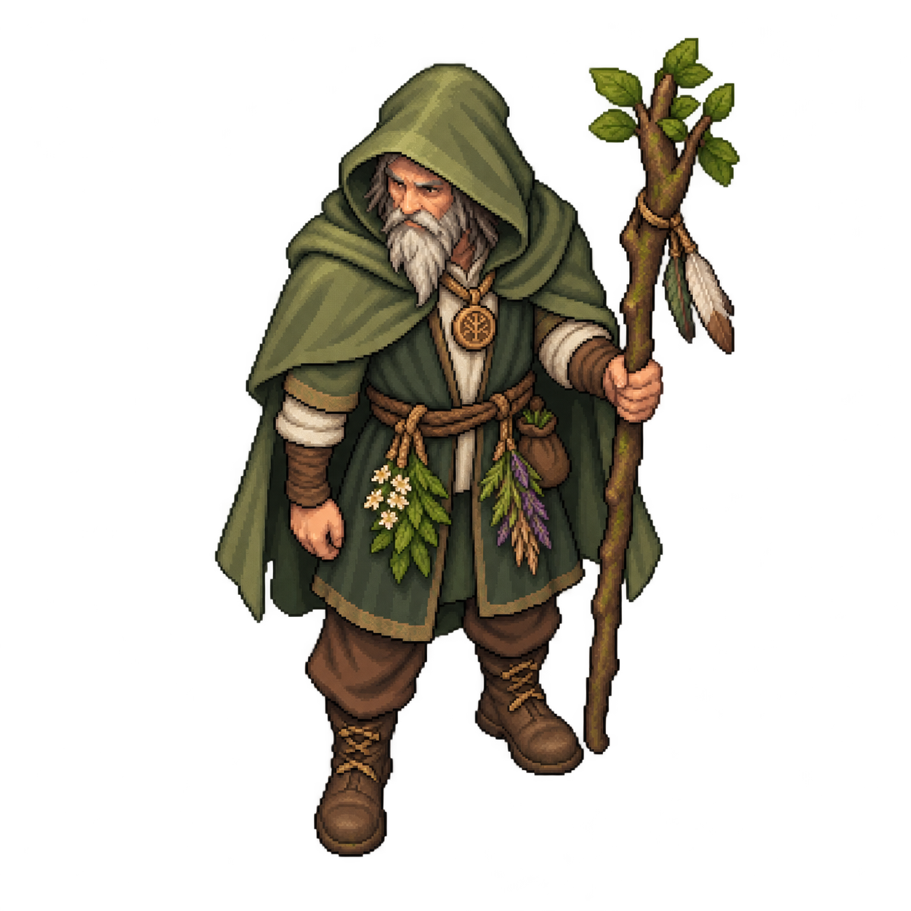
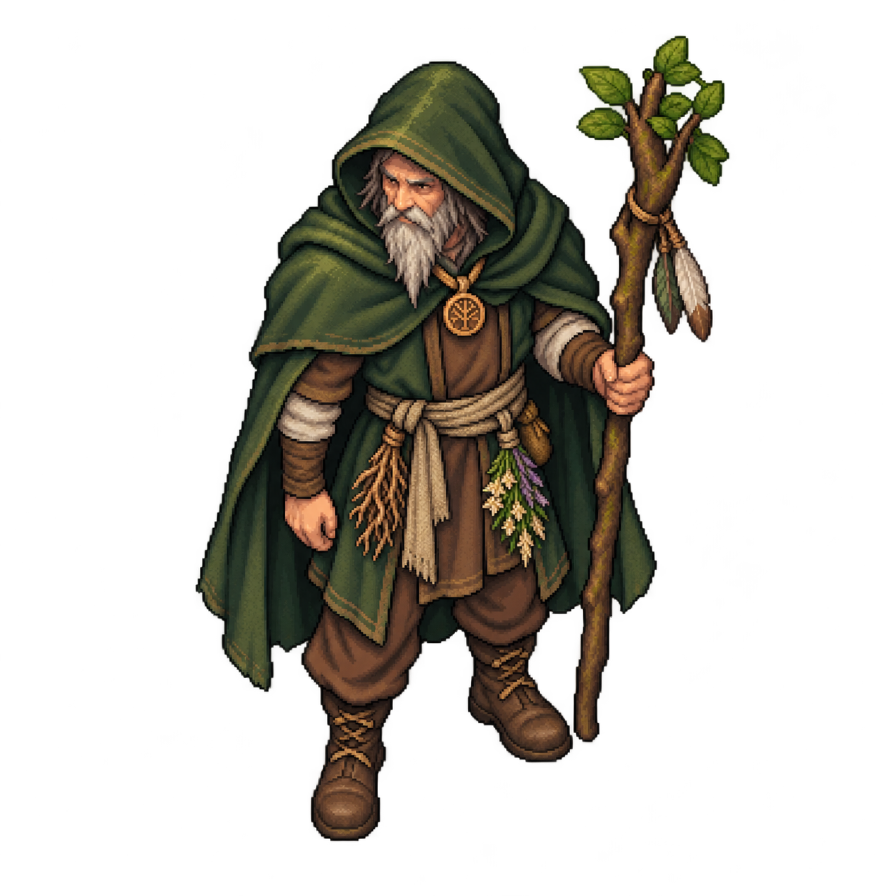

# Друид: три варианта игрового спрайта

Из этих вариантов принят **первый — «Лесной странник»**. Исправленный [рабочий образ](../../../src/assets/characters/druid-standing-detail.png) получил отдельную связку корешков слева от зрителя вместо цветов. Для экрана выбора подготовлен отдельно перерисованный [пиксельный сидящий образ](../../../src/assets/characters/druid-camp-source.png), преобразуемый в текстуру 40×56. Главное меню сохраняет прежний вид. Для комнаты используется [упрощённый рисунок для игры](../../../src/assets/characters/druid-game-source.png), который преобразуется в текстуру 32×40. Ниже сохранены исходные три варианта для сравнения. Один ракурс сверху, нейтральная поза в полный рост и сопоставимый масштаб. Основа — зрелый мужчина с капюшоном, неухоженной острой седой бородой, тканевым плащом и посохом из кривой сосновой ветки с листьями и перьями. Ориентир образа — друид из принятого главного меню.

Все три PNG имеют размер **1254×1254** и прозрачный фон. Высота основной непрозрачной фигуры различается не более чем на 5 пикселей. Это исходные варианты для сравнения; рабочая игровая сетка теперь 32×40, кадры направлений и движений ещё предстоит подготовить. Исходная тройка была сгенерирована отдельно для обсуждения образа; выбранная и исправленная версия теперь используется в игре.

## 1. Лесной странник

Широкий мохово-зелёный плащ, сдержанные тканевые слои и связки растений на поясе. Базовый вариант с наиболее простым силуэтом.

[Открыть исходный PNG](druid-01-wanderer.png)

## 2. Травник

Более светлый шалфейный плащ, льняной нижний слой, заметные связки трав и небольшой мешочек с корнями. Акцент на образе травника.

[Открыть исходный PNG](druid-02-herbalist.png)

## 3. Природный маг

Плотный тёмно-зелёный плащ, земляная туника, тканевый пояс и древесный медальон. Акцент на более тяжёлом и зрелом образе.

[Открыть исходный PNG](druid-03-nature-mage.png)

## Как посмотреть

На GitHub откройте PNG и используйте «Download raw file» для скачивания оригинала. После `git pull --ff-only` эти же файлы находятся в папке `docs/art/druid-sprites-v1` на компьютере. Их можно открыть обычным просмотрщиком изображений.

Исправленная версия первого варианта подключена в игру. Следующий художественный этап — отдельно согласовать направления, ходьбу и другие движения.
