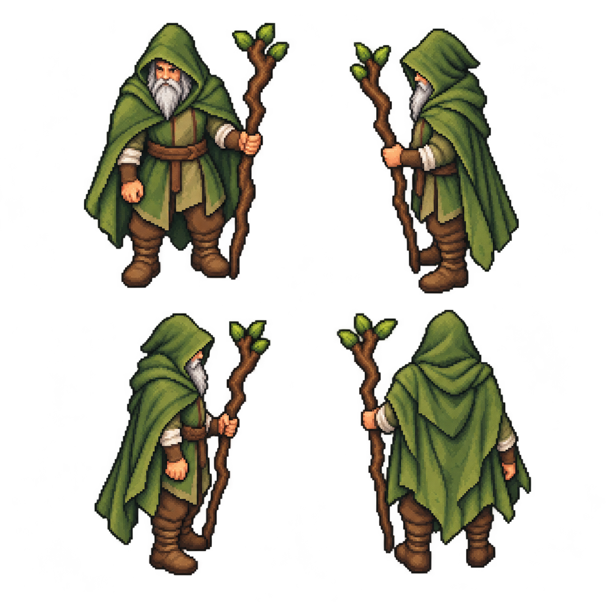

# Друид: единый лист четырёх ракурсов

Принятый пользователем лист по [друиду из указанного эскиза поляны](../druid-detail-preview-v1/gameplay-druid-preview.png). Предыдущие четыре отдельных спрайта отклонены за чрезмерное упрощение и удалены.

[Открыть картинку в полном размере](druid-four-views.png)

Порядок ракурсов:

| | Слева | Справа |
| --- | --- | --- |
| Верхний ряд | Лицом к игроку | Смотрит влево |
| Нижний ряд | Смотрит вправо | Спиной к игроку |

Это **одна исходная картинка 1254×1254**, с четырьмя фигурами на прозрачном фоне. Сохранена непосредственно из генерации: без нарезки на кадры, уменьшения пиксельной сетки, ограничения палитры или последующего упрощения. Художественный запрос — сохранить образ из эскиза и яснее показать лицо, бороду, складки одежды, сапоги и фактуру ветки-посоха.

Посох остаётся в левой руке друида, как в исходном эскизе: спереди — справа для зрителя, со спины — слева. Для боковых видов задан поворот всего тела вместе с головой и ногами. Пользователь одобрил лист для игрового героя. Подключены четыре неподвижных ракурса; кадров ходьбы и промежуточного поворота пока нет.

Лист подключён в игру: W — спиной, S — лицом к игроку, A — влево, D — вправо. Исходный PNG сохранён без изменений. При загрузке фигуры копируются 1:1 в четыре кадра 512×640 с общей точкой опоры у ног. Размер на поляне и геометрия столкновений сохраняются. После остановки остаётся последнее направление; диагональ использует последнюю нажатую активную клавишу. Меню не изменены. Для скачивания откройте PNG на GitHub и нажмите «Download raw file». После `git pull --ff-only` он находится в `docs/art/druid-turnaround-v3/druid-four-views.png`.
