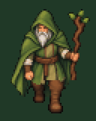

# Ходьба друида вниз: первая проба

[Посмотреть движение — GIF](walk-down-preview.gif) · [Открыть лист кадров — PNG](walk-down-64x80.png)

Четыре кадра для направления **S — вниз, лицом к игроку**, расположены в PNG слева направо:

1. Контакт: левая нога друида (справа для зрителя) впереди.
2. Проходное положение ног.
3. Противоположный контакт: правая нога впереди.
4. Противоположное проходное положение, переход к первому кадру.

Лист имеет размер **256×80**, каждый кадр — **64×80**, фон прозрачный. Координаты кадров: (0, 0), (64, 0), (128, 0), (192, 0). Общая опора ног — строка 75.

Ноги подготовлены по одной общей художественной пробе. Верх персонажа, лицо, борода и посох взяты из принятого фронтального спрайта, чтобы они не меняли форму от кадра к кадру. Для встречного шага отражается только область ног; голова и посох не зеркалятся. В проходных кадрах тело чуть приподнимается на один пиксель. Это простой первый цикл с акцентом на ногах, без отдельного размаха рук.

GIF показывает цикл на месте: четыре кадра по 140 мс, полный оборот 560 мс, бесконечное повторение. Кадры увеличены ровно ×3 без сглаживания; фон добавлен только для просмотра. Палитра GIF ограничена форматом, игровой источник — прозрачный PNG.

**В игру анимация пока не подключена.** Текущие четыре направления и управление сохранены. После `git pull --ff-only` GIF и PNG можно открыть обычным просмотрщиком в папке `docs/art/druid-walk-down-v1/`. На GitHub скачивание оригинала доступно через «Download raw file».
