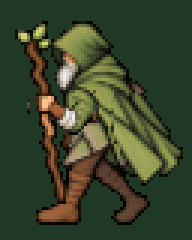

# Ходьба влево: стабильная левая рука с посохом

Вариант **подключён к игре на A**: четыре кадра по 160 мс, полный цикл 640 мс. Принятая полоса PNG загружается без перерисовки. Правая рука полностью скрыта плащом. Левая рука, кисть, рукав и посох образуют один неизменный передний слой; между кадрами он только немного смещается по вертикали.

- [Посмотреть GIF](walk-left-preview.gif).
- [Четыре готовых кадра, увеличенные ×7](walk-left-source.png).
- [Игровая полоса PNG 256×80](walk-left-64x80.png).

Ноги используют прежние четыре фазы и короткий размах: ближняя левая впереди → дальняя правая проходит под тазом → дальняя правая впереди → ближняя левая проходит под тазом. Новые позы ног не генерировались. При локальной очистке убранного посоха восстановлены пиксели под ним; вне маски рук и древка рисунок копируется из предыдущих кадров 1:1. Нижние контуры сапог и защищённые центральные участки ног совпадают с прежними пикселями.

## Слои

| Файл | Назначение |
| --- | --- |
| [walk-left-body-64x80.png](walk-left-body-64x80.png) | Четыре базовых кадра тела и ног, без видимых рук и старого посоха в очищенных областях |
| [left-arm-staff-64x80.png](left-arm-staff-64x80.png) | Единственный рисунок ближней левой руки, кисти, рукава и посоха |
| [walk-left-layers.json](walk-left-layers.json) | Размеры, порядок слоёв, темп и вертикальные смещения |
| [body-inpaint-source.png](body-inpaint-source.png) | Сгенерированная локальная подложка для восстановления плаща и поверхности под убранными руками/посохом |
| [arm-staff-source.png](arm-staff-source.png) | Подробный исходник единственного слоя руки с посохом |

На каждом кадре передний слой рисуется **после тела и ног**. Поэтому ноги не могут перекрыть его, а посох остаётся в той же левой руке. Правая рука не имеет отдельного слоя и скрыта плащом. Положение, форма и цвета кисти/рукава не перерисовываются для каждой фазы.

Сетка **64×80**. Последовательность вертикальных смещений слоя руки: **0, −1, 0, +1 пиксель**, без горизонтальных смещений, отражений или изменения масштаба между кадрами. По **160 мс на кадр**, полный цикл **640 мс**. Слои PNG имеют альфа 0 или 255; палитра PNG не ограничена.

Готовая полоса `walk-left-64x80.png` собрана из этих слоёв. `walk-left-source.png` теперь является листом просмотра готовых кадров с увеличением ×7 ближайшим соседом, а не новым независимым художественным рисунком. GIF увеличен до **192×240** ближайшим соседом; общая палитра ограничена 256 цветами только для GIF.

Проверены точное совпадение непрозрачных пикселей переднего слоя во всех PNG-кадрах после учёта смещения, неизменность его цветов в GIF, порядок композиции, сохранение защищённых участков ног/сапог, прозрачность, четыре фазы и темп GIF. При подключении проверены последовательность четырёх фаз на A, остановка после отпускания клавиши и упора в препятствие, размер и физическое тело. Меню и принятые спрайты ходьбы вверх/вниз сохранены.

Файлы доступны после `git pull --ff-only` в `docs/art/druid-walk-left-v3/`. Для скачивания отдельного файла на GitHub используйте **Download raw file**.
