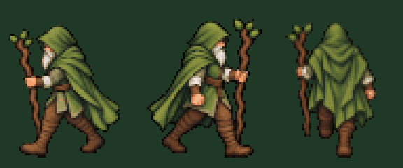

# Ходьба друида влево, вправо и вверх

Три новых цикла для просмотра и выбора, **пока без подключения к игре**. Каждый содержит четыре полностью перерисованные позы. Образ и движение всего тела опираются на принятую [ходьбу вниз](../druid-walk-down-v2/README.md) и [четыре стоящих ракурса](../druid-turnaround-v3/druid-four-views.png).

## Общее сравнение

Слева направо: **влево (A), вправо (D), вверх (W, со спины)**. GIF увеличивает игровые кадры в три раза без сглаживания.

[Открыть общий GIF](walk-comparison.gif)

## Отдельные файлы

| Направление | Анимация | Игровые кадры | Подробный исходный рисунок |
| --- | --- | --- | --- |
| Влево · A | [GIF](walk-left-preview.gif) | [PNG 256×80](walk-left-64x80.png) | [Четыре позы](walk-left-source.png) |
| Вправо · D | [GIF](walk-right-preview.gif) | [PNG 256×80](walk-right-64x80.png) | [Четыре позы](walk-right-source.png) |
| Вверх · W | [GIF](walk-up-preview.gif) | [PNG 256×80](walk-up-64x80.png) | [Четыре позы](walk-up-source.png) |

Исходные листы 1254×1254 сохранены без изменений. На них порядок кадров — слева направо, сверху вниз. На игровых полосах четыре кадра 64×80 идут слева направо.

Художественное задание сохраняет посох в анатомически левой руке: в левом боковом виде это ближняя рука, в правом — дальняя, со спины — слева для зрителя. Правый цикл нарисован отдельно, а не получен зеркальным отражением левого. Движение задано для таза, полных ног, плеч, рук, посоха и плаща. Неподвижный торс не накладывается поверх новых ног. Убедительность рисунка и шага оценивается по исходникам и GIF перед интеграцией.

Для подготовки всех двенадцати игровых кадров использован один масштаб **1/8**. Каждая фигура уменьшена целиком; отдельные части не переставляются и не отражаются. Горизонтальный ориентир корпуса совмещён с x=32, нижняя граница силуэта — с y=75; непрозрачные пиксели заканчиваются на строке 74. Все целые фигуры помещаются в кадры без обрезания. Альфа PNG приведена к 0 или 255; палитра игровых PNG не ограничена.

Отдельные GIF имеют размер **192×240**, общий — **576×240**. Темп соответствует принятой ходьбе вниз: **160 мс на кадр, 640 мс на цикл**, бесконечное повторение. Общая палитра GIF ограничена 256 цветами только для предпросмотра.

Проверены размеры, прозрачность, различие всех четырёх кадров внутри каждого цикла, различие областей плеч, таза и ног, опорная строка и параметры GIF. Исходный код, подключённая ходьба вниз, неподвижные ракурсы и меню не изменены.

Для скачивания откройте нужный файл на GitHub и нажмите **Download raw file**. После `git pull --ff-only` все файлы находятся в `docs/art/druid-walk-other-directions-v1/`.
