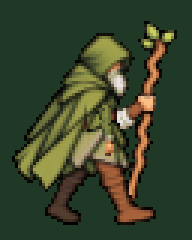

# Принятая ходьба вправо

Последний согласованный вариант **подключён к игре на D**. Четыре кадра по 160 мс, полный цикл 640 мс.

- [Принятая GIF](walk-right-preview.gif).
- [Те же четыре кадра, увеличенные ×7](walk-right-source.png).
- [Подключённая полоса PNG 256×80](walk-right-64x80.png).

Свободная ближняя правая рука имеет короткий широкий рукав, небольшое сгибание в локте и качается примерно на ±12°. Посох остаётся в дальней анатомически левой руке и рисуется за телом; его цвет и форма согласованы с левым циклом.

Игровая полоса подготовлена из четырёх кадров принятой GIF 192×240. Каждый блок 3×3 соответствует одному пикселю сетки 64×80: позы и цвета скопированы без новой генерации, прозрачность восстановлена из исходных кадров этой GIF. Зелёный фон предпросмотра не входит в игровой спрайт. Цвета непрозрачных пикселей PNG точно совпадают с принятой GIF. Увеличенный лист показывает эту же полосу без сглаживания.

В игре цвет обоих сапог дополнительно приведён к тёмно-коричневой коже из принятых циклов вверх/вниз. Это одноразовая коррекция рабочей текстуры при загрузке (`src/rendering/druidBootColors.ts`), только для коричневых пикселей нижней части ног; силуэт, прозрачность, четыре позы, плащ, руки и посох сохраняются. Анимация использует рабочий ключ `druid-walk-right-source-boots`. Исходные PNG и GIF этой папки оставлены без изменения.

Размер героя, опора ног и физическое тело сохранены. `DRUID_WALKS` задаёт источник и темп; `RoomScene` запускает цикл при движении и возвращает прежнюю стоящую позу после остановки или упора в препятствие.

Проверены точность переноса всех четырёх фаз и цветов GIF в PNG, прозрачность 0/255 и опора ног. `npm run build` и `npm test` проверяют загрузку, последовательность кадров на D, движение, остановку и столкновения.

Остальные исходники тела/руки и JSON с описанием слоёв в этой папке — архив промежуточной подготовки до последних исправлений GIF. Они не загружаются игрой и не воспроизводят финальную полосу напрямую. Текущий согласованный рисунок находится в GIF и `walk-right-64x80.png`.
