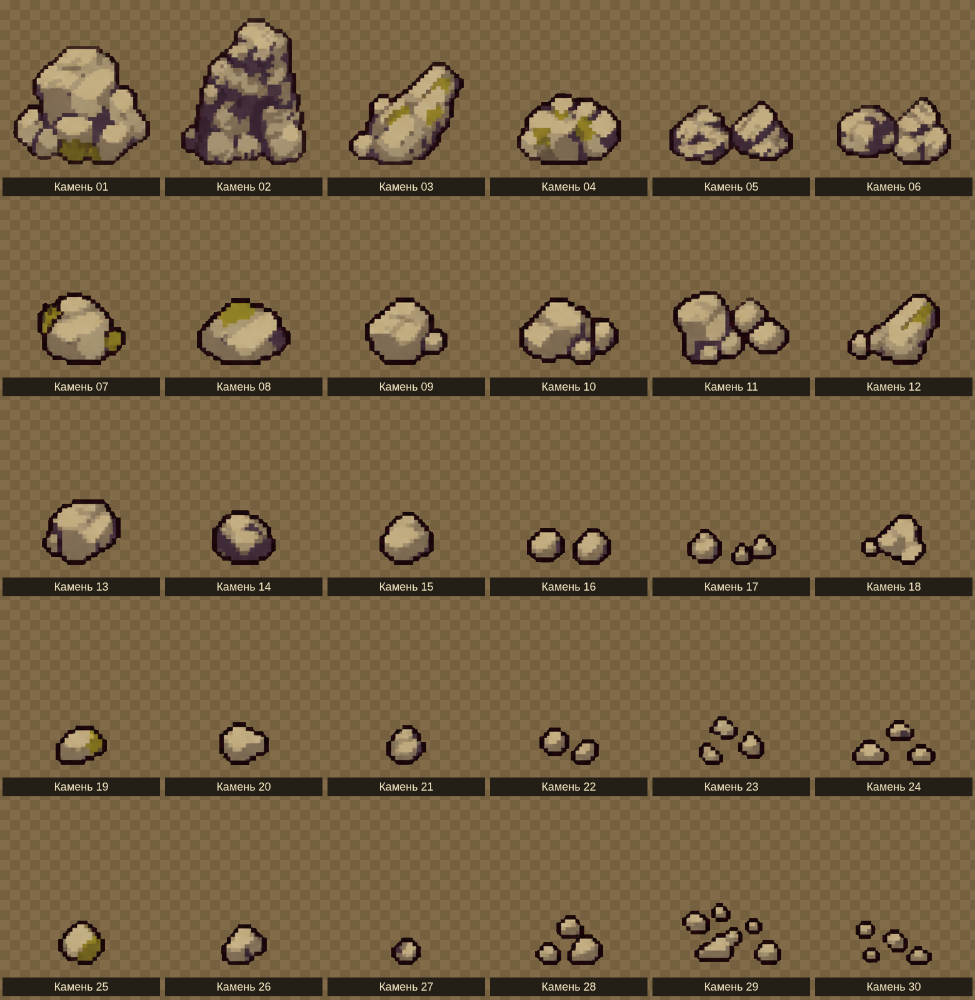

# Сохранённая коллекция камней

**30 вариантов камней и каменных групп остаются подключены к игре.** На локации случайно размещаются 12–20 объектов этого типа. PNG камней сохранены без изменений.

[Открыть лист целиком](rocks-preview.png)

Отдельные файлы находятся в [sprites](sprites/): `rock-01.png` … `rock-30.png`. [rocks-atlas.png](rocks-atlas.png) содержит те же рисунки на прозрачном фоне, без подписей. [sprites.json](sprites.json) перечисляет размеры и координаты кадров. Фильтр NEAREST, масштаб в мире 0,5; каменная группа считается одним физическим препятствием.

Прежние деревья и сухой ствол из этой коллекции удалены. Теперь используются [четыре новых хвойных дерева](../conifer-trees-v1/README.md). Кустов, декоративных травинок, листьев и цветов на поле нет.
