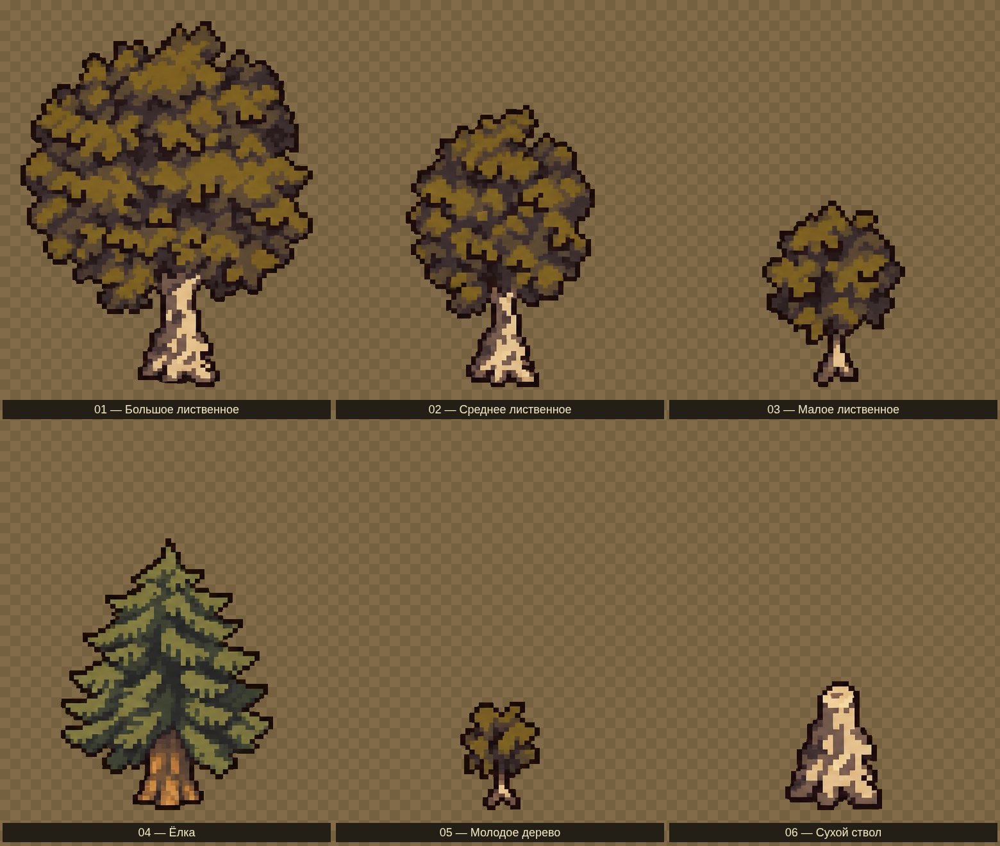

# Деревья и камни — подключённая коллекция

Восстановленный набор по присланному референсу: **5 деревьев, 1 сухой ствол и 30 камней/каменных групп**. Сохранено направление пиксельного рисунка и палитры. Обрезанные верхушки лиственных деревьев и правая сторона ёлки дорисованы; при восстановлении отдельные детали могут отличаться от референса.

**Пять деревьев и все 30 вариантов камней подключены к игре.** Случайно размещаются 45–63 дерева и 12–20 камней/групп на локацию; кустов 4–7. Сухой ствол остаётся отдельным вариантом для просмотра, центрального пня на игровой локации нет.

## Деревья

[Открыть лист целиком](trees-preview.png)

| Номер | Отдельный PNG |
| --- | --- |
| 01 | [Большое лиственное дерево](sprites/tree-01-oak-large.png) |
| 02 | [Среднее лиственное дерево](sprites/tree-02-oak-medium.png) |
| 03 | [Малое лиственное дерево](sprites/tree-03-oak-small.png) |
| 04 | [Ёлка с восстановленной кроной](sprites/tree-04-pine.png) |
| 05 | [Молодое дерево](sprites/tree-05-sapling.png) |
| 06 | [Сухой ствол](sprites/tree-06-dead-trunk.png) |

## Камни

[Открыть лист целиком](rocks-preview.png)

Отдельные файлы находятся в [sprites](sprites/): `rock-01.png` … `rock-30.png`. Каменные группы сохранены вместе, чтобы не терять их композицию. Растения и цветы из нижней части референса не включены в набор камней.

## Файлы и подготовка

- Каждый объект имеет прозрачный фон, чёткую альфу 0/255 и свободные поля по 8 пикселей.
- Листы предпросмотра используют шахматную подложку; она не входит в отдельные PNG.
- [trees-atlas.png](trees-atlas.png) и [rocks-atlas.png](rocks-atlas.png) содержат те же рисунки на прозрачном фоне, без подписей.
- [sprites.json](sprites.json) перечисляет файлы, их размеры и координаты в атласах. Атласы и отдельные PNG совпадают пиксель в пиксель.
- Деревья и камни отображаются в игре с масштабом 0,5, без изменения PNG. Точки опоры и физические основания заданы в `src/data/environment.ts`: деревья сталкиваются основаниями стволов, камни — нижней частью; одна группа камней считается одним препятствием.

Проверены все 36 файлов: прозрачность, свободные поля, непустые рисунки и совпадение с атласами. Скачать можно через **Download raw file** на странице отдельного PNG или получить всю коллекцию командой `git pull --ff-only`.
