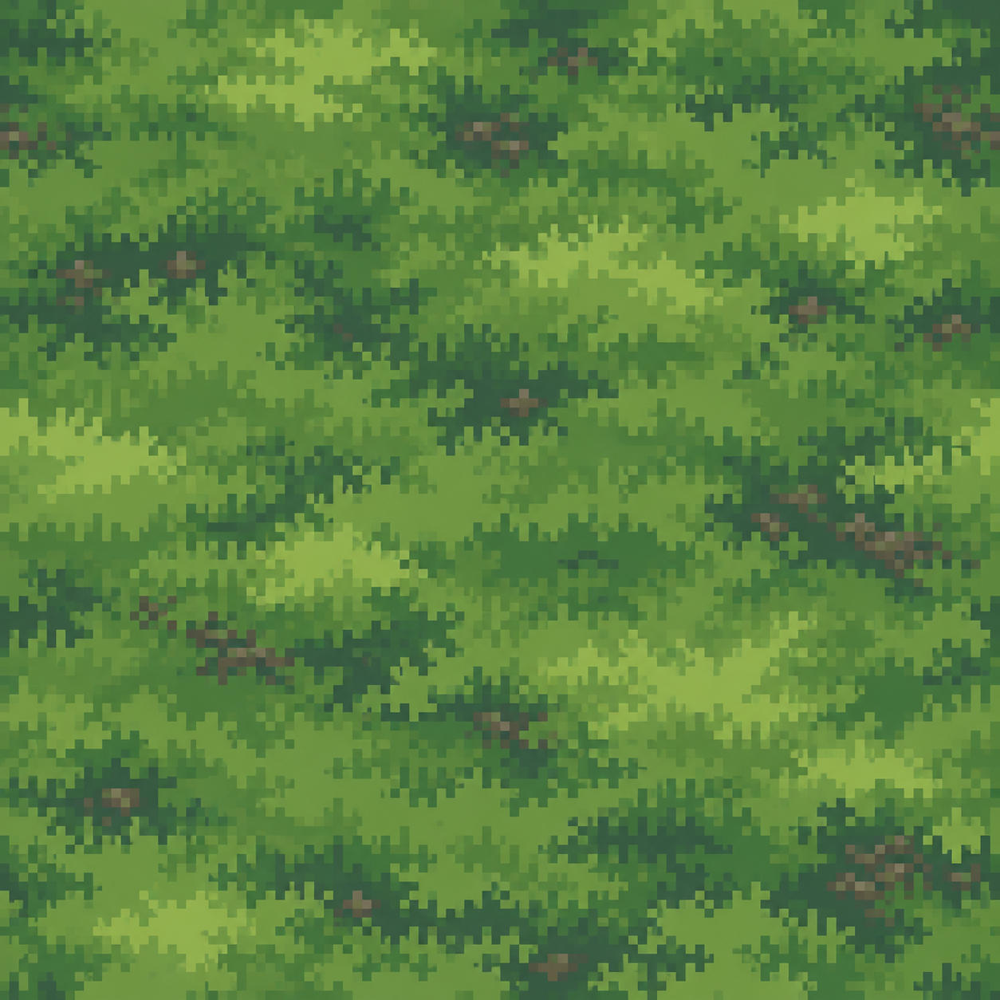

# Лесная подстилка — эскиз 1

[Открыть картинку целиком](forest-floor.png)

Отдельный визуальный вариант травы и мха для поверхности земли. Референсы: [лесная сцена](../54745270c4172d0663edc548cd5a7587.jpg) и [крупный фрагмент травы](../c3e467bb5f529d23e9ca1a1562128800.jpg). Цвета и формы использованы как ориентир; это новая генерация, а не точная копия исходника.

Эскиз пока не подключён к игре. При выборе этого варианта отдельно подготовим размер игровых тайлов и проверим их стыковку.
