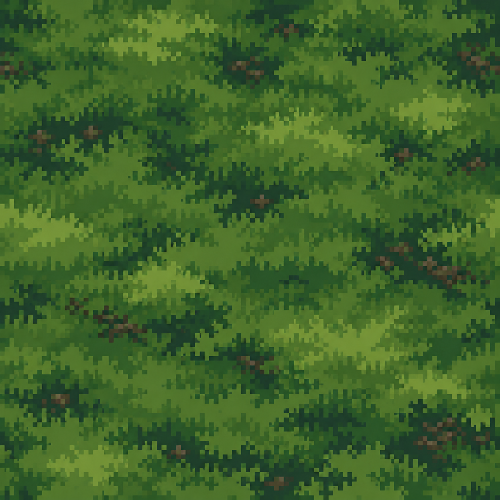

# Лесная подстилка — варианты

[Открыть картинку целиком](forest-floor.png)

## На тон темнее

[Открыть тёмный вариант целиком](forest-floor-darker.png)

Отдельная более тёмная версия первого эскиза. Первый файл сохранён без изменений для сравнения.

Отдельный визуальный вариант травы и мха для поверхности земли. Референсы: [лесная сцена](../54745270c4172d0663edc548cd5a7587.jpg) и [крупный фрагмент травы](../c3e467bb5f529d23e9ca1a1562128800.jpg). Цвета и формы использованы как ориентир; это новая генерация, а не точная копия исходника.

Тёмный вариант принят и подключён к игре. Первый файл сохраняется для сравнения.

Вместо повторения одинаковых квадратов алгоритм image quilting собирает единое поле по seed из случайных вырезок рабочей копии 256×256. Размер фрагмента — 96×96, перекрытие — 24 пикселя, возможны 8 поворотов/отражений; лучший стык выбирается из 12 кандидатов. Затем граница проходит по похожим пикселям в перекрытии, без размытия цветов. Локация использует 1032 таких фрагмента в поле 3072×1728. Пиксель результата занимает 1,25 игровой единицы — вдвое мельче первого игрового варианта; физический размер фрагмента составляет 120×120 единиц. R меняет seed и рисунок подстилки, изменение окна его сохраняет.

Код алгоритма: [forestFloor.ts](../../../src/world/forestFloor.ts). Исходные картинки сохранены без изменений.
