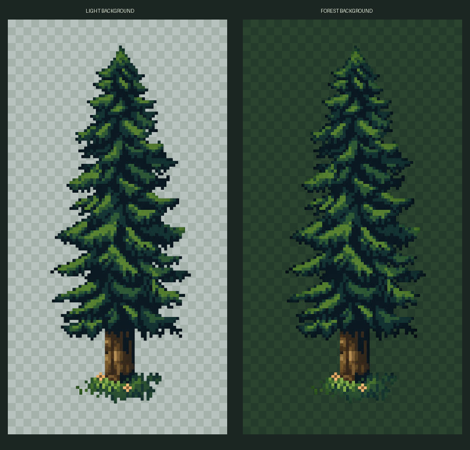

# Сосна — обработанный вариант для просмотра

[Посмотреть на светлой и лесной подложках](pine-preview.png)

[Прозрачный PNG спрайта](pine.png) · [Присланный исходник](../1a01c02e21e6853499f9df607190c50f.jpg)

Подготовлен отдельный обработанный спрайт с прозрачным фоном: убраны подложка, рамка и надпись. Сохранены общий силуэт, зелёно-синяя гамма кроны, тёплый ствол и небольшая растительность у основания. Допускаются небольшие исправления контура; это не пиксельная копия JPEG. Сырой PNG сохранён в исходном размере результата 935×1682; размер для игры выберем при подключении. Подложки листа просмотра в спрайт не входят. В присланном исходнике видна подпись `VNITTI`.

Сосна пока не подключена к игре. Предыдущие четыре дерева сохранены в [conifer-trees-v1](../conifer-trees-v1/README.md), но исключены из случайной генерации. Сейчас на локации **0 деревьев**. Активный пул задаётся отдельно через `TREE_SPAWN_POOL` в `src/data/environment.ts`.
