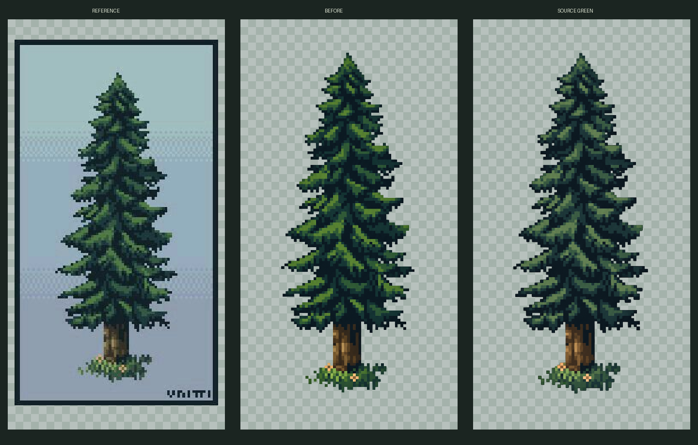

# Сосна — обработанный вариант для просмотра

## Зелень ближе к исходнику

[Сравнить референс, прежний и новый варианты](pine-dark-green-preview.png)

[Прозрачный PNG с тёмной зеленью](pine-dark-green.png)

Зелень стала менее жёлтой и насыщенной, с более холодными тёмными оттенками, ближе к присланному исходнику. Ствол сохраняет тёплую коричневую гамму. Этот вариант одобрен и подключён к игре напрямую, без изменения PNG. Прежний вариант и его лист просмотра сохранены. Размер исходного спрайта — 935×1683; масштаб 0,15625 даёт примерно 146×263 игровых единицы. Точка опоры исходного изображения — (464, 1536). Игровые размеры находятся в [pine.json](../../../src/assets/environment/pine.json), сведения об исходнике — в [pine-dark-green.json](pine-dark-green.json).

Нижняя часть зоны столкновения сокращена: из прежнего основания **32×18** убраны нижние **14 игровых единиц** (`bodyInsetBottom`), рабочий прямоугольник — **32×4**. Верхняя граница и ширина прежние, поэтому сокращается именно невидимый выступ под стволом. С учётом прямоугольника у ног друида высотой 25 его сапоги при подходе снизу теперь останавливаются в 11 единицах от точки опоры дерева вместо 25. Изображение дерева, его положение, тень и цвета не менялись. Архивные деревья не затронуты. Физика, генератор и планирование путей мышей используют один `obstacleRect`.

## Прежний вариант

[Посмотреть на светлой и лесной подложках](pine-preview.png)

[Прозрачный PNG спрайта](pine.png) · [Присланный исходник](../1a01c02e21e6853499f9df607190c50f.jpg)

Подготовлен отдельный обработанный спрайт с прозрачным фоном: убраны подложка, рамка и надпись. Сохранены общий силуэт, зелёно-синяя гамма кроны, тёплый ствол и небольшая растительность у основания. Допускаются небольшие исправления контура; это не пиксельная копия JPEG. Сырой PNG сохранён в исходном размере результата 935×1682; размер для игры выберем при подключении. Подложки листа просмотра в спрайт не входят. В присланном исходнике видна подпись `VNITTI`.

При первом подключении размещались 45–63 сосны. Сейчас на локации случайно размещается **70–99 деревьев**: эта одобренная сосна и [новое лиственное дерево](../broadleaf-tree-v1/README.md), независимый выбор 50/50 для каждого места. Предыдущие четыре дерева сохранены в [conifer-trees-v1](../conifer-trees-v1/README.md), но исключены из случайной генерации. Активный пул задаётся отдельно через `TREE_SPAWN_POOL` в `src/data/environment.ts`.
