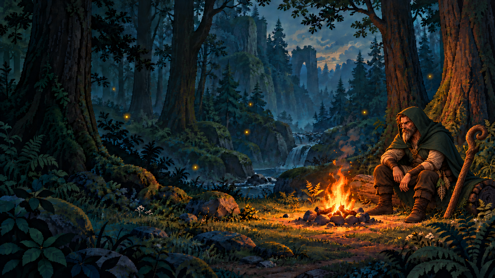
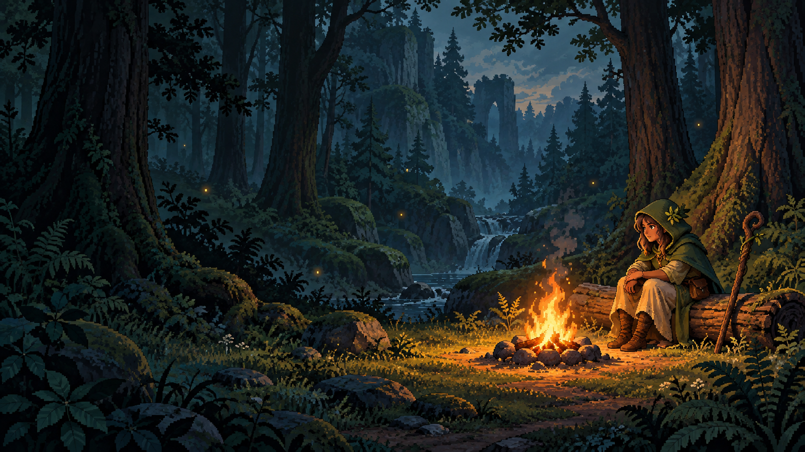

# Визуальные концепты

Это черновики для обсуждения. Визуальный стиль игры пока не утверждён. Изображения не подключены к игре; меню и игровой процесс в этой ветке не менялись.

## Актуальный концепт — дикий бородатый друид

Пользователю понравились общая композиция и визуальное направление первого изображения. Последний ориентир для героя — друид из Diablo II: суровые зрелые черты лица, жилистая мужская фигура и рыжеватые волосы. Борода неухоженная, с одобренной острой клиновидной формой. Зелёный капюшон снова надет на голову. Плащ и штаны имеют более ровную ткань со складками, без точек, колючек и растительного покрытия. Деревянный посох сделан толще и массивнее. Сохранены тканевая туника, тяжёлые сапоги и связки трав на поясе. Наплечник в виде лапы исключён. Лес, костёр и место для меню сохранены как основа композиции.

Показ генерации в чате у пользователя оказался недоступен. По его просьбе использовать другой способ передачи актуальное изображение сохранено здесь. Для следующих правок обновляем этот же файл и ссылку вместо добавления новых вариантов в папку. История изменений сохраняется в Git.

Подтверждённые требования для следующих вариантов и будущих игровых спрайтов:

- Друид обязательно мужчина 45+ с бородой и зрелыми чертами лица.
- Борода неухоженная, образ более дикий, фигура и экипировка мужественные; меняем персонажа целиком, а не только лицо.
- Визуальный ориентир — друид Diablo II, с сохранением нашего плаща и исключением наплечника в виде лапы. Форма бороды острая, клиновидная.
- Герой должен читаться как друид: больше ткани, меньше кожаных ремней, травы и коренья на поясе.
- Капюшон надет на голову. Плащ и штаны — ровная ткань с читаемыми складками, без точек, колючек и растительного покрытия. Посох более массивный, с толстым деревянным стволом.
- Будущие кнопки «Играть» и другие пункты меню располагаются слева от костра.
- Образ героя остаётся магическим друидом без превращений в животных.

Перед интеграцией согласовываем окончательный вариант изображения и оформление кнопок. Игровой персонаж в прототипе пока использует прежнюю временную графику.

## Главное меню — лес и костёр, вариант 1

Первое направление: мягкая пиксельная графика, прохладный тёмный лес и тёплый свет костра. Друид сидит справа, слева оставлено место для будущего меню. Изображение сгенерировано как художественный концепт, не как финальный игровой ресурс.

Ориентиры пользователя: The Binding of Isaac и игра, вероятно, The King Is Watching. Страницу Steam во время подготовки открыть не удалось, поэтому точные детали второго референса ещё не сверены.

Что обсуждаем перед интеграцией:

- Подходит ли уровень детализации или нужны более простые и мультяшные формы?
- Подходит ли палитра леса и костра, насколько светлым должно быть меню?
- Как должен выглядеть друид: силуэт, лицо, одежда и аксессуары?

Текущий концепт — единое неподвижное изображение. Для будущей анимации костра, персонажа или окружения понадобится отдельно подготовить слои и кадры после выбора композиции и стиля.

Посмотреть изображение можно на GitHub. Для скачивания используйте действие загрузки исходного файла или скачайте ZIP этой ветки. Картинка сохранена в отдельной ветке `art/menu-forest-v1`; обычное обновление `main` не добавляет её в игру.
